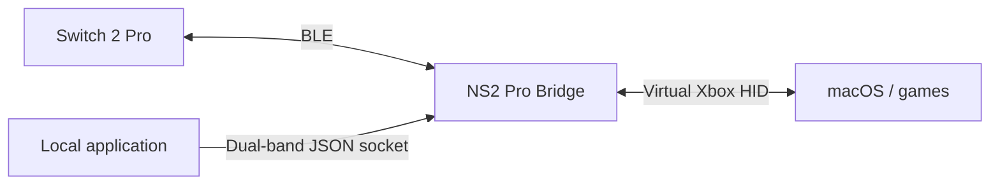

# NS2 Pro Bridge

[简体中文](README.zh-CN.md)

A standalone Nintendo Switch 2 Pro Bluetooth adapter for macOS, providing virtual Xbox controller input, ordinary rumble and a local dual-band haptics interface.

## Technical details



- **Input**: CoreBluetooth reads buttons and calibrated sticks; CoreHID publishes an `Xbox Wireless Controller` device. Face buttons map by physical position. ZL/ZR become fully pressed Xbox triggers.
- **Controller window**: overlays live input on a controller photograph and displays connection state, device name and identifier, discovery-time RSSI and battery voltage from report05. Firmware battery level (0–9), charging and external-power flags appear only after a valid report09 arrives; the app does not infer a precise percentage. The native Settings window (`⌘,`) contains gain, the dual-band interface and a 0.3-second vibration test.
- **Connection feedback**: plays the controller's built-in connection vibration, `0A/02` sample 3, after initialization.
- **Ordinary rumble**: Xbox output reports retain left/right intensity, timing and repeats. Left output uses 160 Hz and right output 320 Hz; trigger amplitudes merge into the corresponding main motor. This path cannot reconstruct the original HD vibration waveform.
- **Dual-band haptics**: applications can supply independent amplitude and frequency for the low/high bands on each side through a local JSON socket. Applications must explicitly integrate this interface.
- **Lifecycle**: disconnect, sleep and exit clear vibration. A physical link loss retains the virtual device with neutral input until explicit disconnect or exit. Dual-band commands expire within one second and discard superseded ordinary effects; ordinary indefinite effects have a renewable five-second limit.

### HD vibration: frequency encoding

Each actuator receives two independent amplitude/frequency pairs, conventionally named LF and HF. Both frequency fields use the same logarithmic conversion in [NS2Rumble.c](Sources/NS2Transport/NS2Rumble.c):

$$
f_c=\operatorname{clamp}(f,40,1252),\qquad
q=\operatorname{round}\left(1+96\log_2\frac{f_c}{10}\right),\qquad
\hat f(q)=10\cdot2^{(q-1)/96}\ \mathrm{Hz}.
$$

There are 96 codes per octave: 80, 160, 320 and 640 Hz map to 289, 385, 481 and 577. Rounding contributes at most 6.25 cents, or approximately 0.362% relative frequency error, against the clamped target; this is a quantization bound, not a hardware accuracy claim. The 40–1252 Hz input range maps to codes 193–670. Its upper endpoint decodes to approximately 1252.57 Hz.


*Left: implemented conversion and acoustic peaks. Right: measured peak deviations from that conversion. The 16 carrier estimates come from two recordings of one controller at seven distinct codes, covering approximately 50–640 Hz; the observed deviations range from −0.103% to +0.114%. Peak estimation searches near the candidate frequency. These measurements support the conversion at the sampled frequencies, rather than establishing full-range accuracy or a confidence interval.*

The frequency code occupies all ten bits. In particular, HF code 577 (`0x241`) produced a peak near 640.49 Hz: bit 9 belongs to the frequency value, rather than being stripped as an enable flag. The two pairs are packed into one 40-bit little-endian word per actuator:

| Bits | 0–9 | 10–19 | 20–29 | 30–39 |
| --- | --- | --- | --- | --- |
| Field | LF frequency | LF amplitude | HF frequency | HF amplitude |

The five-byte words occupy offsets 2–6 and 18–22 of the 42-byte BLE payload. Each side has a preceding command byte: `0x50 | (sequence & 15)` for active output, or `0x10 | (sequence & 15)` to stop. A zero-amplitude band also receives frequency code zero; that zero is inactive, not a carrier to decode with the formula.

Amplitude is handled separately: `round(192 × gain × clamp(amplitude, 0, 1))`. At the default gain of 2, amplitude 0.5 becomes code 192. This scales amplitude codes while preserving both carriers; it does not calibrate actuator force or perceived intensity against a console. Ordinary Xbox rumble supplies intensity only, so its 160/320 Hz carriers are chosen by the adapter; the dual-band interface preserves application-supplied frequencies.

[Measurement data and method](docs/data/README.md) · [Vector SVG](docs/figures/rumble-frequency.svg) · [PDF](docs/figures/rumble-frequency.pdf). Regenerate all three figure formats with Python:

```sh
python3 -m pip install -r tools/requirements-figures.txt
python3 tools/plot_rumble_frequency.py
```

## Usage

Requires macOS 26+, a Switch 2 Pro controller and Bluetooth.

### Connect

1. Release the controller from any other application currently using it.
2. Open the app and use its window or menu-bar controls. It does not connect automatically.
3. Open Settings (`⌘,`) to select vibration gain (default 2×) and optionally enable the local dual-band interface, then choose **连接**. Allow Bluetooth access if macOS requests it.
4. Hold the controller's top SYNC button until the player lights flash. Wait for **手柄已连接** and check the player light, then start the game.

Choose **断开** in the controller window to release the controller, or quit the app. Sleep disconnects it; reconnect manually after waking. The default gain comes from earlier user testing, rather than console calibration.

### Controls

| Switch 2 Pro | Xbox output |
| --- | --- |
| A / B / X / Y | B / A / Y / X |
| L / R | LB / RB |
| ZL / ZR | LT / RT, fully pressed |
| + / − | Start / Back |
| Stick clicks / D-pad | Stick clicks / D-pad |
| Home / Capture | Guide / Share |

Games may handle Guide and Share differently. Controller recognition and ordinary rumble depend on the target game's controller support.

## Local dual-band interface

When connected with **允许本机应用发送双频震动** enabled in Settings, the app binds `~/.ns2pro-bridge/haptics.sock`, a Unix datagram socket accessible only to the current user. Each UTF-8 JSON datagram supplies a complete frame for both sides. A standard-library Python client is included:

```sh
python3 tools/haptics.py \
  --left  0.15 160 0.1 320 \
  --right 0.15 160 0.1 320 \
  --seconds 1
```

Each side takes low amplitude, low frequency, high amplitude and high frequency. This command drives a connected controller. Amplitudes range from 0–1 and frequencies from 40–1252 Hz; the earlier acoustic measurements covered approximately 50–640 Hz. Sustained effects should renew a 200 ms lease about every 50 ms. A successful send confirms datagram delivery to the kernel, not motor execution.

See the [v1 protocol](docs/native-haptics.md) for the JSON schema, lease and stop behavior, arbitration and errors.

## Known limitations

- One controller over Bluetooth; no USB, iOS or iPadOS support.
- No gyro, NFC, headphone audio or custom C/GL/GR mapping to Xbox output.
- No per-game profiles, login launch or automatic updates.

## License

The project code uses the [MIT License](LICENSE) and retains upstream attribution. The controller photograph is copyrighted by Nintendo and is not covered by MIT; see its [source and rights notice](Resources/Controller/ATTRIBUTION.md). Other notices are in [THIRD_PARTY_NOTICES.md](THIRD_PARTY_NOTICES.md). The repository contains no game resources, keys, saves or game runtime.
