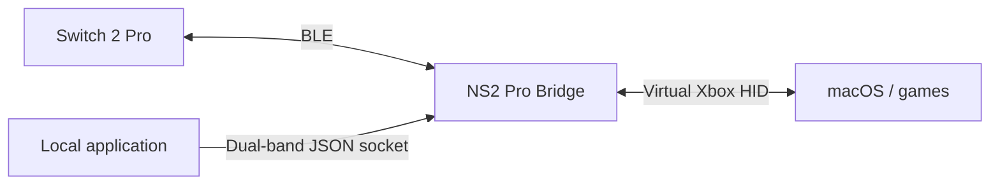

# NS2 Pro Bridge

[简体中文](README.zh-CN.md)

A standalone Nintendo Switch 2 Pro Bluetooth adapter for macOS, providing virtual Xbox controller input, ordinary rumble and a local dual-band haptics interface.

The BLE transport and vibration encoder were extracted from [smbw-mobile](https://github.com/DanielZhangyc/smbw-mobile). This app runs independently of the game runtime and does not modify game processes or files.

## Overview

This is an experimental 0.1.0 build. Twenty-eight offline tests and local build checks have passed on Apple Silicon with Swift 6.4 and the macOS 27 SDK. The Apple Development-signed app connects to a physical controller; Apple GameController receives A/B presses and continuous stick changes through the virtual Xbox device. The user has confirmed the controller-image highlights and built-in connection vibration. Report09 has shown battery level 7/9, battery power and no charging; report05 previously read 3.495 V. Specific SDL/Steam games, changing power states and ordinary/dual-band motor output still need testing. See the [validation record](docs/validation.md).

The original BLE backend has physical-controller evidence for input, player lights and dual-band vibration. Those results do not replace end-to-end testing of this extracted app. Absolute vibration strength has not been calibrated against a Switch console.

## Technical details



- **Input**: CoreBluetooth reads buttons and calibrated sticks; CoreHID publishes an `Xbox Wireless Controller` device. Face buttons map by physical position. ZL/ZR become fully pressed Xbox triggers.
- **Controller window**: overlays live input on a controller photograph and displays connection state, device name and identifier, discovery-time RSSI and battery voltage from report05. Firmware battery level (0–9), charging and external-power flags appear only after a valid report09 arrives; the app does not infer a precise percentage. The native Settings window (`⌘,`) contains gain, the dual-band interface and a 0.3-second vibration test.
- **Connection feedback**: plays the controller's built-in connection vibration, `0A/02` sample 3, after initialization; its command acknowledgement and physical effect have been confirmed.
- **Ordinary rumble**: Xbox output reports retain left/right intensity, timing and repeats. Left output uses 160 Hz and right output 320 Hz; trigger amplitudes merge into the corresponding main motor. This path cannot reconstruct the original HD vibration waveform.
- **Dual-band haptics**: applications can supply independent amplitude and frequency for the low/high bands on each side through a local JSON socket. Applications must explicitly integrate this interface.
- **Lifecycle**: disconnect, sleep and exit clear vibration. A physical link loss retains the virtual device with neutral input until explicit disconnect or exit. Dual-band commands expire within one second and discard superseded ordinary effects; ordinary indefinite effects have a renewable five-second limit.

## Build and launch

Requires macOS 26+, a Switch 2 Pro controller, Bluetooth and Xcode with the macOS 26 SDK or later and Swift 6.2+. Intel Macs and macOS 26 hardware have not been tested.

### Signing

System-wide controller operation requires Apple's `com.apple.developer.hid.virtual.device` entitlement. The **HID Virtual Device development capability** is available for local development; use a macOS provisioning profile that grants it and matches `dev.danielzhangyc.ns2pro-bridge`, together with the corresponding signing identity. A certificate alone does not grant this entitlement.

```sh
git clone https://github.com/DanielZhangyc/ns2pro-bridge.git
cd ns2pro-bridge
swift test --jobs 2
PROVISIONING_PROFILE="/absolute/path/NS2ProBridge.provisionprofile" \
SIGN_IDENTITY="Apple Development: Your Name (TEAMID)" \
bash scripts/build-app.sh
```

The output is `dist/NS2 Pro Bridge.app`. The script validates the profile, builds, packages and signs; it does not launch or install the app. With neither signing variable set, `bash scripts/build-app.sh` creates an ad-hoc build that can open but **disables controller connection**. Setting only one variable is an error. Granting Bluetooth permission does not enable the unprovisioned build. Notarization and distribution have not been completed.

### Connect

1. Finish the current game and quit other adapters, including WaveBird and game-specific direct BLE backends.
2. Open the provisioned app and use its window or menu-bar controls. It does not connect automatically.
3. Open Settings (`⌘,`) to select vibration gain (default 2×) and optionally enable the local dual-band interface, then choose **连接**. Allow Bluetooth access if macOS requests it.
4. Hold the controller's top SYNC button until the player lights flash. Wait for **手柄已连接** and check the player light, then start the game.

Choose **断开** in the controller window to release the controller, or quit the app. Sleep disconnects it; reconnect manually after waking. The default gain comes from earlier user testing, rather than console calibration.

### Controls

| Switch 2 Pro | Xbox output |
| --- | --- |
| A / B / X / Y | B / A / Y / X |
| L / R | LB / RB |
| ZL / ZR | LT / RT, fully pressed |
| + / − | Start / Back |
| Stick clicks / D-pad | Stick clicks / D-pad |
| Home / Capture | Guide / Share |

Games may handle Guide and Share differently. Controller recognition and ordinary rumble depend on the target game's controller support.

## Local dual-band interface

When connected with **允许本机应用发送双频震动** enabled in Settings, the app binds `~/.ns2pro-bridge/haptics.sock`, a Unix datagram socket accessible only to the current user. Each UTF-8 JSON datagram supplies a complete frame for both sides. A standard-library Python client is included:

```sh
python3 tools/haptics.py \
  --left  0.15 160 0.1 320 \
  --right 0.15 160 0.1 320 \
  --seconds 1
```

Each side takes low amplitude, low frequency, high amplitude and high frequency. This command drives a connected controller. Amplitudes range from 0–1 and frequencies from 40–1252 Hz; the earlier acoustic measurements covered approximately 50–640 Hz. Sustained effects should renew a 200 ms lease about every 50 ms. A successful send confirms datagram delivery to the kernel, not motor execution.

See the [v1 protocol](docs/native-haptics.md) for the JSON schema, lease and stop behavior, arbitration and errors.

## Known limitations

- One controller over Bluetooth; no USB, iOS or iPadOS support.
- No gyro, NFC, headphone audio or custom C/GL/GR mapping to Xbox output.
- No per-game profiles, login launch or automatic updates.
- Specific SDL/Steam games, Guide/Share, stick-direction checks, charging/power transitions and ordinary/dual-band motor output still need hardware validation. Connected quit has been checked for process exit and stop-packet submission, without motor telemetry. No universal game compatibility is claimed.

## License

The project code uses the [MIT License](LICENSE) and retains upstream attribution. The controller photograph is copyrighted by Nintendo and is not covered by MIT; see its [source and rights notice](Resources/Controller/ATTRIBUTION.md). Other notices are in [THIRD_PARTY_NOTICES.md](THIRD_PARTY_NOTICES.md). The repository contains no game resources, keys, saves or game runtime.
