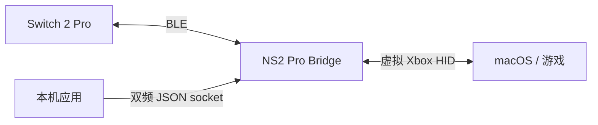

# NS2 Pro Bridge

[English](README.md)

面向 macOS 的独立 Nintendo Switch 2 Pro 蓝牙适配器，提供虚拟 Xbox 手柄输入、普通震动和本机双频震动接口。

BLE 传输和震动编码器提取自 [smbw-mobile](https://github.com/DanielZhangyc/smbw-mobile)。应用独立于游戏运行时，不修改游戏进程或文件。

## 说明

目前为 0.1.0 实验版，已在 Apple Silicon、Swift 6.4、macOS 27 SDK 环境通过 28 项离线测试及本机构建检查。开发签名应用已连接真实手柄，Apple GameController 通过虚拟 Xbox 设备收到 A/B 按键和连续摇杆变化，用户已确认手柄图高亮与内置连接震动正常。report09 实测显示电量等级 7/9、电池供电、未在充电；report05 此前读取到 3.495 V。具体 SDL/Steam 游戏、电源状态变化及普通与双频电机输出仍待专项验证。具体结果见[验证记录](docs/validation.md)。

提取前的 BLE 后端已有输入、玩家灯和双频震动的实机证据，但这些结果不能替代独立应用的端到端验收。绝对震动力度尚未与 Switch 主机校准。

## 技术



- **输入**：CoreBluetooth 读取按键和校准后的摇杆，CoreHID 创建名为 `Xbox Wireless Controller` 的虚拟设备。面键按物理位置映射，ZL/ZR 转为按到底的 Xbox 扳机。
- **手柄窗口**：在手柄照片上叠加实时输入，显示连接状态、设备名称与标识符、发现时的 RSSI，以及 report05 上报的电池电压。收到有效 report09 后才显示固件电量等级（0–9）、充电与外部供电状态，不推算精确百分比。原生设置窗口（`⌘,`）提供震动力度、双频接口和 0.3 秒震动测试。
- **连接反馈**：初始化后播放手柄内置的连接震动 `0A/02` sample 3，已确认命令 ACK 和实际触感。
- **普通震动**：保留 Xbox 输出报告的左右力度、时长和重复信息，左侧使用 160 Hz、右侧使用 320 Hz；扳机振幅合并到同侧主马达。这条路径无法还原原始 HD 震动波形。
- **双频震动**：应用可通过本机 JSON socket，分别指定左右两侧低、高频段的幅度和频率，需要应用主动接入此接口。
- **状态与停止**：断开、睡眠和退出时清空震动。物理链路中断后，虚拟设备保留中立输入，直到主动断开或退出。双频指令最长有效 1 秒，并丢弃被抢占的普通效果；普通无限时长效果最多维持 5 秒，可由新命令续约。

## 构建与启动

需要 macOS 26+、Switch 2 Pro 手柄、蓝牙，以及带 macOS 26 或更新 SDK 的 Xcode 和 Swift 6.2+。Intel Mac 和 macOS 26 实机尚未测试。

### 签名

系统级手柄功能需要 Apple 的 `com.apple.developer.hid.virtual.device` 授权。**HID Virtual Device 开发能力**可用于本机开发；构建时需要提供包含此权限、匹配 `dev.danielzhangyc.ns2pro-bridge` 的 macOS 描述文件，以及对应的签名身份。仅有证书不能取得此权限。

```sh
git clone https://github.com/DanielZhangyc/ns2pro-bridge.git
cd ns2pro-bridge
swift test --jobs 2
PROVISIONING_PROFILE="/absolute/path/NS2ProBridge.provisionprofile" \
SIGN_IDENTITY="Apple Development: Your Name (TEAMID)" \
bash scripts/build-app.sh
```

产物为 `dist/NS2 Pro Bridge.app`。脚本检查描述文件，完成编译、打包和签名，不会启动或安装应用。两个签名变量均未设置时，`bash scripts/build-app.sh` 生成可打开的 ad-hoc 构建，但会**禁用手柄连接**；只设置其中一个变量会报错，允许蓝牙访问也不能启用未授权构建的连接功能。项目尚未完成公证和分发。

### 连接

1. 结束当前游戏，退出 WaveBird 等其他适配器及游戏内置的 BLE 直连后端。
2. 打开已完成授权签名的应用，使用独立窗口或菜单栏控制面板；启动时不会自动连接。
3. 在设置（`⌘,`）中选择震动力度（默认 2 倍），按需启用本机双频接口，再点“连接”。系统请求蓝牙访问时按提示允许。
4. 长按手柄顶部 SYNC，直到玩家灯闪烁。等待显示“手柄已连接”，检查玩家灯，再启动游戏。

在手柄窗口点“断开”或退出应用可释放手柄。Mac 睡眠会断开连接，唤醒后需手动重连。默认力度来自此前的用户实测选择，尚未按主机校准。

### 操作

| Switch 2 Pro | Xbox 输出 |
| --- | --- |
| A / B / X / Y | B / A / Y / X |
| L / R | LB / RB |
| ZL / ZR | LT / RT，按到底 |
| ＋ / － | Start / Back |
| 摇杆按下 / 十字键 | 摇杆按下 / 十字键 |
| Home / Capture | Guide / Share |

不同游戏对 Guide 和 Share 的处理可能不同。输入识别和普通震动取决于目标游戏自身的手柄支持。

## 本机双频接口

连接时在设置中启用“允许本机应用发送双频震动”后，应用会绑定 `~/.ns2pro-bridge/haptics.sock`，这是仅允许当前用户访问的 Unix datagram socket。每个 UTF-8 JSON 数据报完整指定左右两侧的一帧。仓库提供仅使用 Python 标准库的客户端：

```sh
python3 tools/haptics.py \
  --left  0.15 160 0.1 320 \
  --right 0.15 160 0.1 320 \
  --seconds 1
```

每侧四个参数依次为低频幅度、低频频率、高频幅度和高频频率。此命令会驱动已连接的手柄。幅度范围为 0–1，频率范围为 40–1252 Hz；此前的声学测量覆盖约 50–640 Hz。持续效果建议每 50 ms 续一帧，使用 200 ms 租约。发送成功仅表示内核收到数据报，不代表电机实际执行。

JSON 格式、租约与停止行为、抢占规则及错误处理见[本机双频接口 v1](docs/native-haptics.md)。

## 已知限制

- 仅支持单只手柄的蓝牙连接，不支持 USB、iOS 或 iPadOS。
- 不支持陀螺仪、NFC、耳机音频，以及 C/GL/GR 到 Xbox 输出的自定义映射。
- 不提供按游戏保存配置、开机自启和自动更新。
- 具体 SDL/Steam 游戏、Guide/Share、摇杆方向专项、充电与供电状态变化，以及普通与双频电机输出仍待实机验证。连接时退出已确认进程结束和停止包提交，但没有电机遥测；尚未建立通用游戏兼容性结论。

## 许可

项目代码使用 [MIT License](LICENSE)，保留上游署名。手柄照片版权归 Nintendo 所有，不属于 MIT 许可，见[素材来源与权利说明](Resources/Controller/ATTRIBUTION.md)。其他第三方声明见 [THIRD_PARTY_NOTICES.md](THIRD_PARTY_NOTICES.md)。仓库不包含游戏资源、密钥、存档或游戏运行时。
