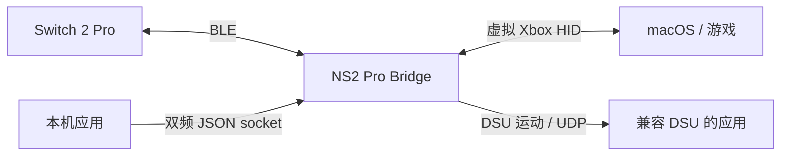
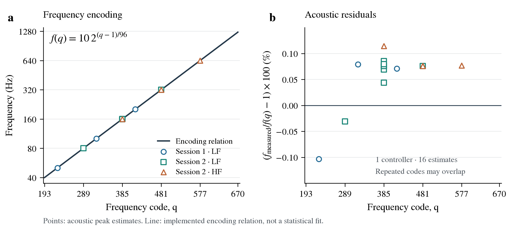

# NS2 Pro Bridge

[English](README.md)

面向 macOS 的独立 Nintendo Switch 2 Pro 蓝牙适配器，提供虚拟 Xbox 手柄输入、普通震动、本机双频震动接口和实验性 DSU 运动输出。

界面支持英语和简体中文，跟随 macOS 的语言偏好；未匹配时使用英语。

## 技术



- **输入**：CoreBluetooth 读取按键和校准后的摇杆，CoreHID 创建名为 `Xbox Wireless Controller` 的虚拟设备。面键按物理位置映射，ZL/ZR 转为按到底的 Xbox 扳机。
- **手柄窗口**：在手柄照片上叠加实时输入，显示连接状态、设备名称与标识符、发现时的 RSSI，以及 report05 上报的电池电压。收到有效 report09 后才显示固件电量等级（0–9）、充电与外部供电状态，不推算精确百分比。原生设置窗口（`⌘,`）提供震动力度、双频与运动接口开关，以及 0.3 秒震动测试。
- **连接反馈**：初始化后播放手柄内置的连接震动 `0A/02` sample 3。
- **普通震动**：保留 Xbox 输出报告的左右力度、时长和重复信息，左侧使用 160 Hz、右侧使用 320 Hz；扳机振幅合并到同侧主马达。这条路径无法还原原始 HD 震动波形。
- **双频震动**：应用可通过本机 JSON socket，分别指定左右两侧低、高频段的幅度和频率，需要应用主动接入此接口。
- **实验性运动接口**：在设置中启用后，本机 DSU/Cemuhook 服务通过 `127.0.0.1:26760`、插槽 0 向兼容应用提供 report05 的加速度和陀螺仪数据。采用传感器默认量程和接收时的单调时钟，不向虚拟 Xbox HID 添加运动通道。
- **附件检测**：report05 可检测耳机插入；关闭运动模式时，report09 还可区分耳机与耳麦，并提供 NFC 处理器原始状态。状态检测不代表 NFC 读卡或音频传输已可用。
- **状态与停止**：断开、睡眠和退出时清空震动。物理链路中断后，虚拟设备保留中立输入，直到主动断开或退出。双频指令最长有效 1 秒，并丢弃被抢占的普通效果；普通无限时长效果最多维持 5 秒，可由新命令续约。

### HD 震动的频率编码

每侧执行器接收两组独立的幅度与频率参数，分别记作 LF、HF。两组频率字段使用相同的对数换算，由 [NS2Rumble.c](Sources/NS2Transport/NS2Rumble.c) 实现：

$$
f_c=\mathrm{clamp}(f,40,1252),\qquad
q=\mathrm{round}\left(1+96\log_2\frac{f_c}{10}\right),\qquad
\hat f(q)=10\cdot2^{(q-1)/96}\ \mathrm{Hz}.
$$

频码每增加 96，频率翻倍。例如，80、160、320、640 Hz 分别对应 289、385、481、577。取整带来的误差最多为 6.25 音分，相对于限幅后的目标频率约为 0.362%；这是编码量化界，不是硬件精度。40–1252 Hz 的输入范围对应频码 193–670，其中上限反算后约为 1252.57 Hz。



*左图为编码换算曲线与声学峰值，右图为观测峰相对换算值的偏差。16 个载频估计来自单只手柄的两份录音，包含 7 个不同频码，覆盖约 50–640 Hz，观测偏差为 −0.103%～+0.114%。分析在候选频率附近寻找峰值；这些结果支持采样频点上的换算关系，不代表全范围精度或置信区间。*

频率字段使用完整的 10 位。HF 频码 577（`0x241`）对应的观测峰约为 640.49 Hz，说明 bit 9 属于频率数值，不能作为独立使能位剥离。每侧的两组参数打包为一个 40 位小端字：

| 位 | 0–9 | 10–19 | 20–29 | 30–39 |
| --- | --- | --- | --- | --- |
| 字段 | LF 频码 | LF 幅码 | HF 频码 | HF 幅码 |

左右两侧的 5 字节参数分别位于 42 字节 BLE 载荷的偏移 2–6 和 18–22。每侧参数前有一个命令字节：输出时为 `0x50 | (sequence & 15)`，停止时为 `0x10 | (sequence & 15)`。幅度为零的频段，其频码也归零；此时表示关闭，不应代入公式理解为实际载频。

幅度独立换算为 `round(192 × gain × clamp(amplitude, 0, 1))`。默认 gain 为 2，因此幅度 0.5 对应幅码 192。这一处理保留两组载频，只缩放幅码，不代表执行器力度或体感已与主机校准。普通 Xbox 震动只提供强度，其 160/320 Hz 载频由适配器指定；双频接口则保留应用传入的频率。

[测量数据与方法](docs/data/README.md) · [矢量 SVG](docs/figures/rumble-frequency.svg) · [PDF](docs/figures/rumble-frequency.pdf)。使用 Python 可重新生成三种格式的图：

```sh
python3 -m pip install -r tools/requirements-figures.txt
python3 tools/plot_rumble_frequency.py
```

## 使用

需要 macOS 26+、Switch 2 Pro 手柄和蓝牙。

### 连接

1. 如果手柄正被其他应用使用，先释放连接。
2. 打开应用，使用独立窗口或菜单栏控制面板；启动时不会自动连接。
3. 在“设置”（`⌘,`）中选择“震动力度”（默认 2 倍），并配置本机接口。双频接口默认开启，“向本机应用提供运动数据（DSU）”默认关闭；修改这些设置前需先断开手柄。
4. 在菜单栏选择“连接手柄”，或点击手柄窗口的连接图标。系统请求蓝牙访问时按提示允许。长按手柄顶部 SYNC，直到玩家灯闪烁。等待显示“手柄已连接”，检查玩家灯，再启动游戏。

在菜单栏选择“断开手柄”、点击手柄窗口的断开图标，或退出应用可释放手柄。关闭最后一个应用窗口会隐藏 Dock 图标，适配器仍在菜单栏运行。Mac 睡眠会断开连接，唤醒后需手动重连。默认力度来自此前的用户实测选择，尚未按主机校准。

### 操作

| Switch 2 Pro | Xbox 输出 |
| --- | --- |
| A / B / X / Y | B / A / Y / X |
| L / R | LB / RB |
| ZL / ZR | LT / RT，按到底 |
| ＋ / － | Start / Back |
| 摇杆按下 / 十字键 | 摇杆按下 / 十字键 |
| Home / Capture | Guide / Share |

不同游戏对 Guide 和 Share 的处理可能不同。输入识别和普通震动取决于目标游戏自身的手柄支持。

## 本机双频接口

连接时在设置中启用“允许本机应用发送双频震动”后，应用会绑定 `~/.ns2pro-bridge/haptics.sock`，这是仅允许当前用户访问的 Unix datagram socket。每个 UTF-8 JSON 数据报完整指定左右两侧的一帧。仓库提供仅使用 Python 标准库的客户端：

```sh
python3 tools/haptics.py \
  --left  0.15 160 0.1 320 \
  --right 0.15 160 0.1 320 \
  --seconds 1
```

每侧四个参数依次为低频幅度、低频频率、高频幅度和高频频率。此命令会驱动已连接的手柄。幅度范围为 0–1，频率范围为 40–1252 Hz；此前的声学测量覆盖约 50–640 Hz。持续效果建议每 50 ms 续一帧，使用 200 ms 租约。发送成功仅表示内核收到数据报，不代表电机实际执行。

JSON 格式、租约与停止行为、抢占规则及错误处理见[本机双频接口 v1](docs/native-haptics.md)。

## 本机运动接口（实验性）

连接手柄前，在设置中启用“向本机应用提供运动数据（DSU）”。在兼容 DSU/Cemuhook 的应用中，将服务器设为 `127.0.0.1:26760`，选择插槽 0。按键和摇杆仍通过 Xbox HID 提供，DSU 仅提供加速度和陀螺仪数据。

仓库提供仅使用 Python 标准库的客户端，可检查实际收到的运动数据包：

```sh
python3 tools/dsu-monitor.py --seconds 10
```

运动模式不订阅 report09，启用后无法提供固件电量等级、充电、外部供电和 NFC 状态，仍可读取电池电压与耳机插入标志。切换运动开关前需先断开手柄。

## 已知限制

- 仅支持单只手柄的蓝牙连接，不支持 USB、iOS 或 iPadOS。
- 运动数据使用默认传感器量程，尚未应用工厂或用户校准。已在单只手柄上验证真实 BLE 到 DSU 数据流与断开清理，尚未验证目标模拟器内的轴向和传感器精度。
- C、GL、GR 可在手柄窗口检测和显示，但不转发到 Xbox HID；不提供按键重映射或按游戏保存配置。
- NFC 与耳机目前仅提供状态检测。NFC 读写和蓝牙耳机音频尚未实现，耳机插拔与耳麦分类仍待实物验证。USB 耳机音频是独立的系统设备路径，本蓝牙适配器尚未实现或验证。
- 不提供登录时启动和自动更新。

DSU 接口、验证依据和待补协议见[运动与附件协议说明](docs/motion-accessories.md)。

## 许可

项目代码使用 [MIT License](LICENSE)，保留上游署名。手柄照片版权归 Nintendo 所有，不属于 MIT 许可，见[素材来源与权利说明](Resources/Controller/ATTRIBUTION.md)。其他第三方声明见 [THIRD_PARTY_NOTICES.md](THIRD_PARTY_NOTICES.md)。仓库不包含游戏资源、密钥、存档或游戏运行时。
